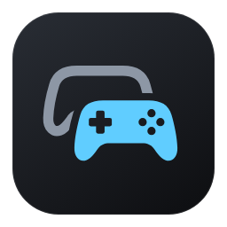
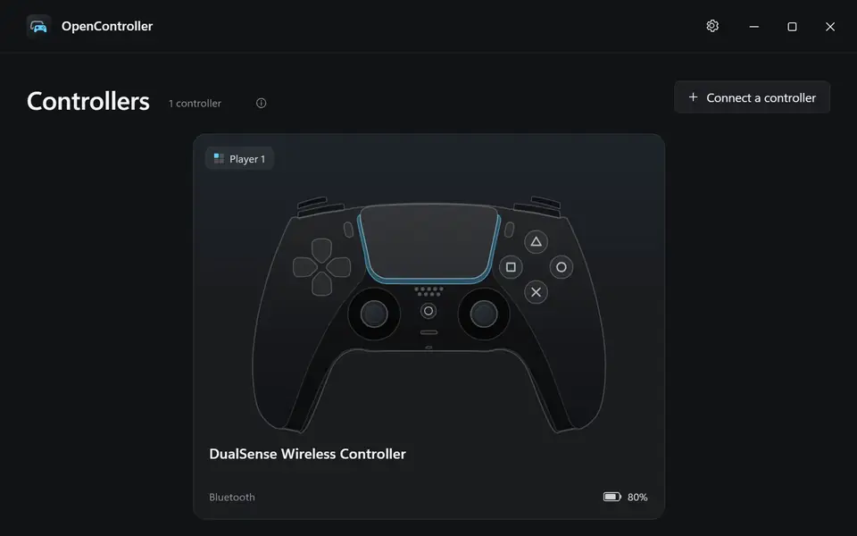
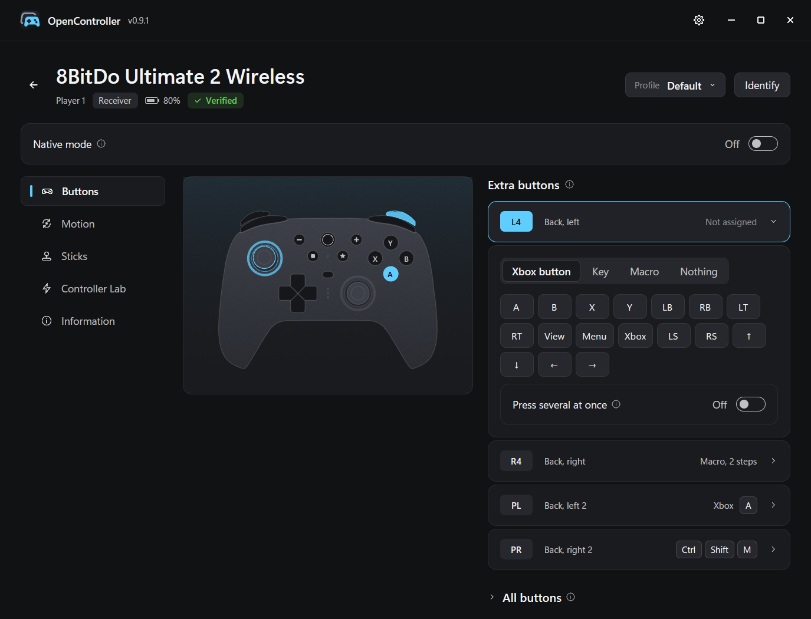

<h1> OpenController</h1>

**Any controller, in any game.**
OpenController turns every controller on your PC into an Xbox controller that games understand:
a DualSense, a Switch Pro Controller, Joy-Cons and an 8BitDo, all at once, each as its own player.
Back paddles and other extra buttons can press Xbox buttons, type keys or play macros, and a
controller with a gyro can aim.

[](https://github.com/Brunovncs/OpenController/releases/latest)
[](https://github.com/Brunovncs/OpenController/releases/latest)
[](https://github.com/Brunovncs/OpenController/releases/latest)



## Features

- **Nothing to map.** Plug in a controller and play. Buttons keep their place, rumble works, and
  each controller lights up with its player number.
- **Extra buttons.** Back paddles, L4 and R4, Capture and the touchpad can press Xbox buttons,
  type a shortcut or play a macro.
- **Gyro aiming**, Flick Stick, and deadzones and curves that fix a worn or drifting stick.
- **Profiles** for each controller, switched by the game in front.
- **Light bar** colours, battery levels and a low battery warning.
- **Native mode** for games that know a controller on their own, like a DualSense with its
  adaptive triggers.
- **Light.** The background process uses up to 4 MB of memory and adds under a millisecond of
  latency.

It reads [hundreds of controllers](https://opencontroller.com.br/en/controllers): PlayStation,
Nintendo, 8BitDo, Flydigi, Steam Deck, handheld PCs and generic pads.



## Install

Every download is on the [latest release](https://github.com/Brunovncs/OpenController/releases/latest).
The official website is [opencontroller.com.br](https://opencontroller.com.br), and there is no other.

**Windows 10 and 11.** Run `open-controller-<version>-windows-x64-setup.exe` (`arm64` on an ARM PC).
It installs for your user, without administrator rights, and updates from inside the app.
OpenController needs two free drivers, [ViGEmBus](https://github.com/nefarius/ViGEmBus) and
[HidHide](https://github.com/nefarius/HidHide), which Settings, Requirements installs with one
click. The installer is not code-signed, so SmartScreen warns the first time: More info, then Run
anyway.

**Linux.** Extract `open-controller-<version>-linux-x64.tar.gz` (or `arm64`) and run `./install.sh`.
It asks for your password once, for the rule that lets it make virtual controllers. It needs glibc
2.35 or newer, as in Ubuntu 22.04, Debian 12 and Fedora 36.

**macOS.** Unzip `open-controller-<version>-macos-universal.zip` and move OpenController to
Applications. It is not notarised, so open it once, then click Open Anyway in System Settings,
Privacy & Security. Games on macOS already read most controllers, so there OpenController adds
extra buttons, the light bar, battery levels and profiles.

## Building

```powershell
cargo build --release
cargo test --workspace
```

It needs [Rust](https://rustup.rs), CMake and a C compiler, since SDL is built from source. On
Windows without the Windows SDK, use `cargo build --profile local`. On Linux, also the development
files of libudev, xkbcommon, Wayland, fontconfig and Vulkan. How it works is in
[docs/design.md](docs/design.md).

## Reporting a problem

OpenController is in beta. Report a problem, on a controller's Information page, sends what it
takes to fix it or add the controller. You can also open an
[issue](https://github.com/Brunovncs/OpenController/issues) or use the
[contact form](https://opencontroller.com.br/#contact).

## License

MIT, see [LICENSE](LICENSE). Third-party code in the release is listed in
[THIRD_PARTY_NOTICES.md](THIRD_PARTY_NOTICES.md).

OpenController is not affiliated with Sony, Microsoft, Nintendo, Valve, 8BitDo or any other
controller maker. Some games, online ones with anti-cheat above all, forbid macros: check a
game's rules first, as what happens to an account is the player's responsibility.
